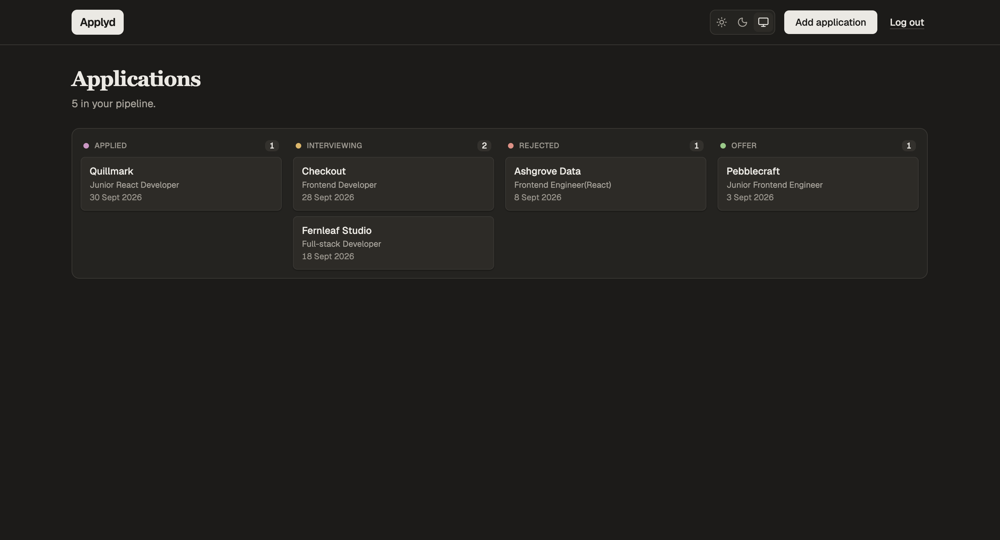
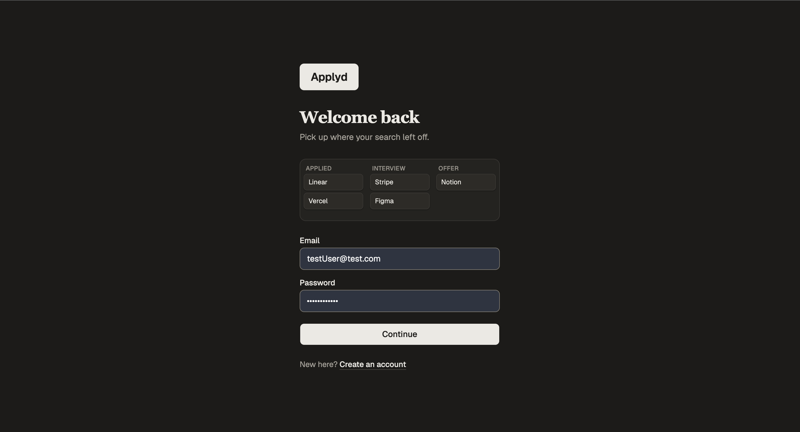
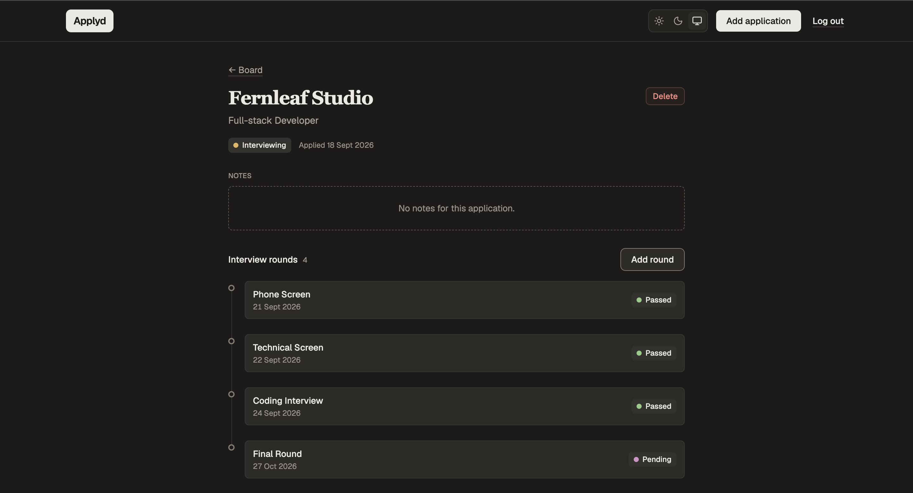

# Applyd

A job application tracker. It replaces the job-search spreadsheet with a status board, a full interview history for each application, and private accounts.

**Live demo:** [job-tracker-steel-ten.vercel.app](https://job-tracker-steel-ten.vercel.app/)

Log in with the demo account:

| Email | Password |
|---|---|
| `testUser@test.com` | `Password7711` |

The backend runs on a free Render instance, so the first request after a quiet period can take up to a minute while it wakes up.



## What it does

- **Board view.** Applications grouped by status: Applied, Interviewing, Rejected, Offer.
- **Interview history.** Each application keeps a timeline of its rounds: type, date and outcome.
- **Accounts.** Register and log in. Every query is scoped to the signed-in user.
- **Create and delete.** Deleting an application also deletes its interview rounds.
- **Light and dark themes.** Light by default, a warm dark mode, and a Light / Dark / System toggle.

## Screenshots

| Login | Application detail |
|---|---|
|  |  |

## Tech stack

**Frontend:** React, TypeScript, Vite, React Router, TanStack Query, React Hook Form, Zod, Tailwind CSS v4, shadcn/ui

**Backend:** Node.js, Express, TypeScript, Prisma 7, PostgreSQL (Neon), Zod, JWT, bcrypt

**Tooling:** Bun workspaces, Vitest, ESLint, GitHub Actions

**Hosting:** Vercel (frontend), Render (backend), Neon (database)

## Engineering choices

- **Shared Zod schemas.** One schema validates a form on the client and the request on the server. Types are inferred from the schemas, not written by hand.
- **Validation at every boundary.** Fetch responses are parsed with Zod before the app uses them. Bad data shows an error state instead of crashing a page.
- **Ownership checks on every route.** Find the record, check it belongs to the user, then act.
- **Database rules for related data.** Interview rounds are deleted with their application through an `ON DELETE CASCADE` migration.
- **No flash of the wrong theme.** A small script in `index.html` applies the saved theme before the page paints.
- **CI on every push and pull request.** The client and server are built and the server tests run on a clean machine.

## Design

The interface follows a direction called "Paper": warm, calm and quiet, with a serif heading and motion only where it shows something arriving where it belongs.

- The direction was chosen from three working login page prototypes.
- `client/PRODUCT.md` records who the app is for and what it must never claim.
- `client/DESIGN.md` records the design system: colour tokens for both themes with measured contrast, type, spacing, components and motion rules.
- Accessibility target is WCAG AA. All motion turns off under the reduced motion setting.

## How it was built

I built Applyd in two phases, on purpose.

### Phase 1: written by hand

I wrote the first version myself, line by line, to learn every layer of a full-stack app:

- A monorepo with an Express API and a React client
- A Postgres schema with Prisma, hosted on Neon
- Authentication with bcrypt and JWT, and middleware that protects every route
- Create, read, update and delete routes with ownership checks
- Zod schemas shared between the client and server
- The board and detail views, with TanStack Query and React Hook Form
- Deployment to Vercel and Render, including the build and module problems that only show up in production
- The first server tests with Vitest

### Phase 2: Claude Code writes, I review

Once I understood the whole codebase, I switched to directing an AI coding agent. The skill I am building now is planning, steering and judging changes rather than typing them. I still have to be able to explain every line that gets merged.

In this phase I added CI, Bun workspaces, runtime validation of API responses, delete with a database migration, and the full "Paper" redesign.

### The workflow

1. **Plan.** Every task starts in plan mode. Claude Code reads the code, proposes a plan, and asks me about anything that is a product decision. Nothing changes until I approve.
2. **Build.** It writes the code. I approve edits as they happen, or let it run in auto mode for low-risk work.
3. **Review.** I read the full diff, and a code review skill gives a second opinion from agents that did not write the code. I verify each finding before acting on it.
4. **Verify.** Builds and tests pass, and I check the result in the browser in both themes.
5. **Ship.** Commit, push, and CI runs on a clean machine. Anything found but not fixed becomes a GitHub issue.

### The Claude Code setup

| Area | What I use | Why |
|---|---|---|
| Model routing | `opusplan`: Opus in plan mode, Sonnet to execute | The stronger model where judgement matters, a cheaper one for the typing |
| Context | `CLAUDE.md` with commands, conventions, known pitfalls, git rules and four working rules (think first, keep it simple, change only what is needed, define how success is checked) | Every session starts with the same project memory |
| Context hygiene | `/clear` between unrelated tasks | Shorter context, lower cost, fewer stale instructions |
| Permissions | `.claude/settings.json` with `ask` rules for `git commit` and `git push` | Approval is enforced even in auto mode, instead of relying on an instruction |
| Design docs | `client/PRODUCT.md` and `client/DESIGN.md` | The agent follows written design rules instead of guessing |

### Skills and plugins

| Tool | What I used it for |
|---|---|
| [Matt Pocock's skills](https://github.com/mattpocock/skills) | `/prototype` to build three login page directions side by side, `/code-review` to review the redesign pull request, and the GitHub issue setup used to file follow-ups with triage labels |
| [Impeccable](https://github.com/pbakaus/impeccable) | `init` to write `PRODUCT.md`, and `extract` to turn the chosen prototype into the `DESIGN.md` design system |
| [Taste](https://github.com/Leonxlnx/taste-skill) | Design direction, and a headless Chrome inspector that screenshots pages at desktop, tablet and mobile widths |

How I treat third-party tools:

- **Read before installing.** Skills and plugins run with the agent's permissions, so I review what they can do first. Before using Taste's scripts, I had Claude Code list every network call, file write and process they start, then checked the key claims myself.
- **Install the minimum.** Impeccable is installed for Claude Code only and without hooks. Skill files are not committed; `CLAUDE.md` lists the install commands.
- **Audit what is installed.** I removed one plugin after finding that its hooks added instructions to every prompt that conflicted with my own review rules.
- **Keep tests off real data.** The automated browser checks used a mocked API and a fake token, so they did not touch the production database.

## Getting started

Requires [Bun](https://bun.sh) and Node 22.

```bash
git clone https://github.com/rishnegi7711/job-tracker.git
cd job-tracker
bun install
```

Create `server/.env`:

```
DATABASE_URL=postgresql://...
JWT_SECRET=a-long-random-string
FRONTEND_URL=http://localhost:5173
```

Create `client/.env`:

```
VITE_API_URL=http://localhost:3000
```

Apply the database migrations, then start both apps:

```bash
cd server && bunx prisma migrate deploy && bun run dev
cd client && bun run dev
```

Checks:

```bash
cd server && bun run build && bun run test --run
cd client && bun run build
```

## What's next

- **Edit applications in the app.** Change status and notes from the board and detail views. The API already supports it; the interface doesn't yet.
- **Status history with dates.** Record every status change with when it happened, instead of overwriting it, so the time between stages can be measured.
- **Metrics dashboard.** Built from my own job search once there is real data behind it:
  - Applications per week, and the trend over time
  - Where applications drop off: applied, interviewing, offer, and which round type I most often fail
  - How long things take: days to a first response, and to a rejection or an offer
- **CV and job posting match.** Score how well a CV fits a posting, with strengths and gaps as structured output validated by Zod, and a small evaluation set to check the scores make sense.
- **An assistant with tools.** Server-side tool use for actions like adding a round or changing a status, scoped to the signed-in user and confirmed before any write.
- Open follow-ups are tracked in [Issues](https://github.com/rishnegi7711/job-tracker/issues).

## License

MIT. See [LICENSE](LICENSE).
